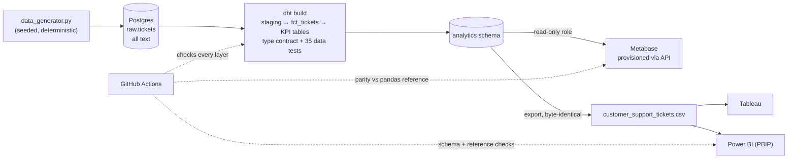
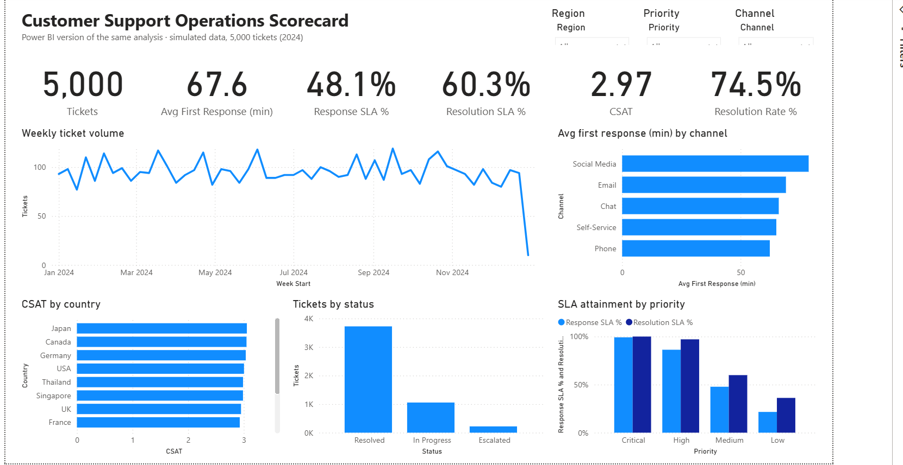
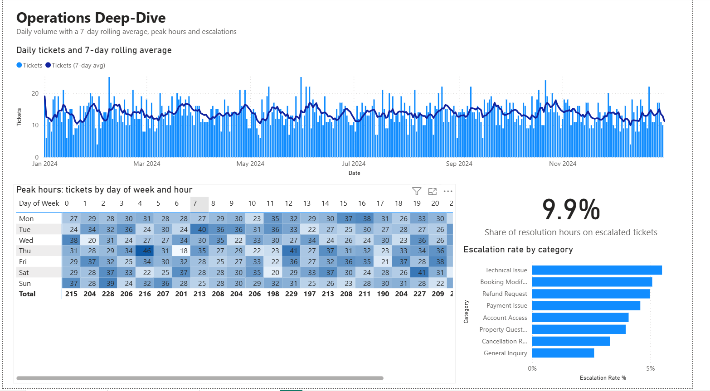
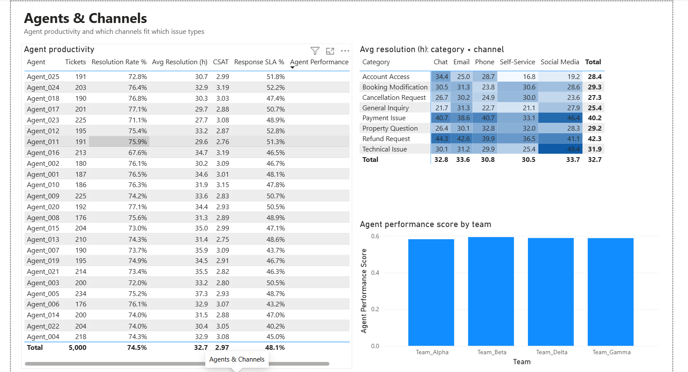

# 📊 Customer Support Operations Analytics

[](https://github.com/AnirudhBabu/CustomerSupportAnalytics/actions/workflows/ci.yml)

## A Comparative BI Study on One Tested Data Platform: Tableau vs. Metabase vs. Power BI

## 🎯 Project Overview
This project was born out of a desire to bridge the gap between raw data processing and professional business intelligence. I simulated a dataset of 5,000 customer support tickets to explore how industry-leading BI tools handle operational data. I first built the analytics suite in Tableau and Metabase, then revisited the project to add a third build in Power BI.

By building the same analytics suite in each environment, I learned when to reach for visual-first storytelling, query-driven technical analysis, or a governed semantic model.

Revisiting the project, I found that the Metabase dashboard had shown **0% SLA compliance for every agent** without anyone noticing, because the database stored the SLA flags as text. So the project now runs on a small analytics platform: one pipeline feeds all three tools, every KPI is defined once, and automated tests compare each tool's numbers with an independent reference. A broken number fails the build instead of reaching a dashboard.

The Goal: Extract actionable insights on SLA compliance, agent productivity, and channel performance to optimize support operations.

## 🏗️ Platform Architecture



| Layer | What it does | Where |
|---|---|---|
| **Generate** | Seeded Python generator; same seed, same data | [`data/data_generator.py`](./data/data_generator.py) |
| **Load** | Lands the CSV in `raw.tickets` as text, untouched | [`pipeline/load_raw.py`](./pipeline/load_raw.py) |
| **Transform** | dbt types the data in staging, builds `fct_tickets` and seven KPI tables. SLA thresholds and KPI formulas are defined once (project vars and macros) | [`transform/`](./transform/) |
| **Guard** | An enforced dbt **contract** on `fct_tickets` fails the build if a column changes type (the original bug). 35 data tests check values, uniqueness, business rules and that every KPI table reconciles to the ticket count | [`transform/models/marts/_marts.yml`](./transform/models/marts/_marts.yml), [`transform/tests/`](./transform/tests/) |
| **Serve** | Metabase reads the analytics schema through a **read-only role**; its own state lives in Postgres, not in a file in the repo. Questions and the dashboard are **provisioned from code** through the Metabase API on every start | [`metabase/`](./metabase/) |
| **Export** | Writes the tested fact table back to the CSV Tableau and Power BI read, byte-identical to the source, so neither tool needed changes | [`pipeline/export.py`](./pipeline/export.py) |
| **Verify** | Unit, contract, integration and end-to-end tests, run by CI on every push | [`tests/`](./tests/), [`.github/workflows/ci.yml`](./.github/workflows/ci.yml) |

## 🛠️ The Tech Stack
* Data Generation: Python (Pandas/NumPy) to create a simulated lifecycle for 5,000 tickets, including CSAT scores and multi-stage timestamps.

* Warehouse & Transformation: PostgreSQL 16 with dbt (staging → marts → metrics), an enforced model contract, generic and singular data tests, and grants to a read-only BI role.

* BI Tool A (Tableau): Used for executive level dashboarding, focusing on LOD (Level of Detail) expressions and interactive UI/UX.

* BI Tool B (Metabase): Self-hosted via Docker; native SQL questions and a technical "Deep-Dive" dashboard, provisioned from code.

* BI Tool C (Power BI): A star-schema semantic model (ticket fact table + date dimension) with DAX measures, saved as a Power BI Project (PBIP) so the model and report are plain text and diffable in Git.

* Platform: Docker Compose for the local stack, GitHub Actions for CI.

## 📈 Visualizations & Insights
1. Executive Operations Scorecard (Tableau)
* Designed for high level stakeholders to monitor department health at a glance.

* Dynamic KPIs: Interactive tracking of Average First Response Time (FRT), SLA Achievement %, and CSAT.

* Interactive Filtering: Built-in global filters for Date Range, Region, and Priority.

* Geographic Mapping: A distribution map visualizing ticket volume vs. satisfaction scores by country.

2. SQL Analytics Deep-Dive (Metabase)
A technical layer focused on granular performance metrics using SQL.

* Trend Analysis: A 7-day rolling average of ticket volume, built with a SQL window function (`AVG() OVER ...`) in the dbt model `kpi_daily_volume`.

* Productivity Heatmap: Analyzed "Peak Hours" vs. "Day of Week" to identify the highest pressure windows for support staff.

* Efficiency Metrics: Developed a "Channel-Category" matrix to identify which support channels are most effective for specific issue types.

3. Semantic Model & Report (Power BI)
The same KPIs rebuilt as reusable DAX measures on one model, so every page and visual uses the same definitions.

* Executive Scorecard: The Tableau KPIs (FRT, SLA %, CSAT, resolution rate) with Region, Priority and Channel slicers.

* Operations Deep-Dive: The 7-day rolling average rebuilt as a DAX measure (`DATESINPERIOD`) instead of a SQL window function, plus a peak-hours heatmap and escalation analysis.

* Agents & Channels: Agent productivity table, including Tableau's Agent Performance Score ported to DAX, and a category × channel resolution-time matrix.

## 📂 Repository Structure
```
data/
  data_generator.py                 seeded ticket generator
  customer_support_tickets.csv      pipeline export read by Tableau and Power BI
pipeline/                           load raw -> run dbt -> export; Dockerfile for the pipeline image
transform/                          dbt project
  models/staging/                   stg_tickets: every raw column typed
  models/marts/                     fct_tickets: enforced contract
  models/metrics/                   kpi_summary, kpi_agent, kpi_daily_volume, kpi_monthly, ...
  macros/                           shared KPI formulas, generic tests, schema naming
  tests/                            singular data tests (business rules, reconciliation)
metabase/
  dashboard.json                    collection, dashboard, questions and layout
  questions/*.sql                   the SQL behind each question
  provision.py                      idempotent provisioning through the Metabase API
powerbi/                            Power BI Project (TMDL model + PBIR report)
tableau/                            Tableau workbook and screenshots
infra/postgres/init/                roles (read-only BI user) and Metabase's app database
tests/                              unit, contract, integration and end-to-end tests
docker-compose.yml                  local stack: Postgres, pipeline, Metabase, provisioning
.github/workflows/ci.yml            CI: unit, pipeline + warehouse parity, full stack e2e
```

## 🚀 Quick Start for Reviewers
View the Live Tableau Dashboard
Explore the interactive Tableau Public workbook here: [Tableau Dashboard](https://public.tableau.com/app/profile/anirudh.babu5470/viz/KPI_17917094833400/CustomerSupportOperationsScorecard?publish=yes)

### Run the Whole Platform Locally (Docker)
1. Clone the repo and switch into it:

   ```
   git clone https://github.com/AnirudhBabu/CustomerSupportAnalytics.git
   cd CustomerSupportAnalytics
   ```

2. Start the stack:

   ```
   docker compose up -d --build
   ```

   This starts Postgres, runs the pipeline (generate → load → dbt build with all data tests → export), starts Metabase and provisions it. The first start takes a few minutes while Metabase initialises. Follow progress with `docker compose logs -f pipeline metabase-setup`.

3. Visit [http://localhost:3000](http://localhost:3000) and log in with `admin@example.com` / `Support-Analytics-2026`. The **Support Operations** dashboard is in the **Support Analytics** collection.

   These are local development defaults. To change them, copy `.env.example` to `.env` and edit it before the first start (Postgres only creates its roles when its volume is first created; `docker compose down -v` resets it).

4. Re-run the pipeline at any time with `docker compose run --rm pipeline`.

   On Linux, the pipeline container runs as user 1000 and writes the export into `data/`; if your user has a different id, run `chmod a+w data` once.

### Troubleshooting
* **dbt fails with "unable to infer all dependencies" for every model.** The clock inside Docker jumped backwards while dbt was parsing (common with Docker Desktop after the computer sleeps). The pipeline retries once automatically. If it still fails, resync the clock (on Windows: `wsl --shutdown`, then restart Docker Desktop) and run `docker compose up -d --build` again.

### Open the Power BI Report
1. Install [Power BI Desktop](https://www.microsoft.com/power-bi/desktop) (Windows).
2. Open `powerbi/CustomerSupportAnalytics.pbip`.
3. Select **Refresh**. The model loads the ticket CSV straight from this GitHub repo, so no setup is needed. If prompted for credentials, choose **Anonymous**.
4. To work offline, go to **Transform data → Edit parameters** and set `TicketsCsvPath` to the local path of `data/customer_support_tickets.csv`.

### Open the Tableau Workbook
Open `tableau/dashboard/Customer Support Analytics.twbx` and point its data source at `data/customer_support_tickets.csv` (**Data → Edit Data Source**), then refresh the extract.

## ✅ Testing

Every number a dashboard shows is checked against an independent pandas implementation of each KPI ([`tests/reference.py`](./tests/reference.py)), so a bug in SQL or DAX shows up as a mismatch instead of being copied into the expected values.

| Suite | What it proves | Needs |
|---|---|---|
| `test_generator` | Data is deterministic and follows the business rules (CSAT only on resolved tickets, one team per agent, SLA flags match thresholds); the committed export is current | Python |
| `test_metabase_provision` | Provisioning creates everything on a fresh Metabase, is idempotent on re-runs, and pushes SQL changes. Runs against a fake Metabase that validates every request against the **OpenAPI spec of the pinned Metabase version** | Python |
| `test_bi_contracts` | Tableau and Power BI read exactly the columns the export provides; every field in the Power BI report and every DAX reference exists in the model; PBIR files match Microsoft's schemas | Python |
| dbt data tests | Types (contract), uniqueness, accepted values, business rules, reconciliation of every KPI table to the ticket count | Postgres |
| `test_warehouse` | Each KPI table, each Metabase question (run as the read-only role) and the export match the reference; the read-only role cannot read raw data or write | Postgres |
| `test_metabase_e2e` | Each question, executed through the Metabase API, returns the reference numbers; provisioning is idempotent against the real server | Running stack |

Run the tests that need only Python:

```
pip install -r requirements/test.txt
python -m unittest discover -s tests -t . -v
```

Database and Metabase tests are skipped unless `PGHOST` (and the other `PG*` variables) or `MB_URL` are set. CI runs all of them: see [`.github/workflows/ci.yml`](./.github/workflows/ci.yml).

## 🖥 Views

1. Tableau

* Dashboard containing all views


* Agent Performance


* Customer Satisfaction by Country


* First Response Channel


* KPI Score Card


* Ticket Distribution by Status


* Weekly Ticket Volume


2. Metabase
* Metabase dashboard


* Agent Productivity by Customer Satisfaction


* Category Channel Performance


* Daily Volume Chart


* Escalation Risk Analysis Bubble Chart


* Monthly CSAT Trends


* Peak Hours Analysis


3. Power BI

* Customer Support Operations Scorecard


* Operations Deep Dive


* Agents & Channels



## ⚖️ Tableau vs. Metabase vs. Power BI

| | Tableau | Metabase | Power BI |
|---|---|---|---|
| **How I built the logic** | Calculated fields and LOD expressions in the workbook | SQL: KPI logic in dbt models, thin native questions on top | DAX measures on a star-schema semantic model |
| **7-day rolling average** | Not built (the Tableau views use weekly totals) | `AVG(...) OVER (ROWS BETWEEN 6 PRECEDING AND CURRENT ROW)` in dbt | `AVERAGEX(DATESINPERIOD(...), [Tickets] + 0)` |
| **Reuse of KPI definitions** | Per workbook | Shared with the warehouse: questions read dbt KPI tables | Defined once in the model, reused by every visual |
| **Setup & hosting** | Desktop app; shared through Tableau Public | Self-hosted Docker container | Desktop app (Windows); sharing needs the Power BI service |
| **Sharing for this project** | Public link, but the data is public too | Anyone who runs the stack | Report file in the repo; online sharing requires a licence |
| **Version control** | `.twbx` is a binary package | Dashboard defined as JSON + SQL files, provisioned through the API | PBIP is plain text (TMDL + JSON), so changes show up as readable diffs |
| **Automated testing** | Column contract with the export | SQL and API results checked against the reference | Model/report integrity and schema checks (DAX itself needs Desktop or the service) |
| **Where it shone here** | Polished, interactive executive dashboard | Fast, transparent ad-hoc SQL analysis | One governed model that keeps every KPI consistent |

**My take:** I'd pick Metabase when the audience is technical and the questions are exploratory, and Power BI when the same KPIs need to stay consistent across many reports and be managed like code. Tableau didn't win me over. Some of that is personal preference, but within the free Public Edition I worked with, it can only read files and Google Drive (no databases, no file from GitHub), and its visuals didn't give me anything Power BI couldn't, so Power BI came out ahead for me. Metabase is the one I'd reach for first: it's set up entirely from code, runs in containers, lets me explore with plain SQL, and has a genuinely great dark mode.

## 🧠 Key Learnings
* Tool Adaptability: I learned how to translate business logic across different BI ecosystems, from Tableau's "Calculated Fields" to SQL in dbt and Metabase to DAX measures in Power BI.

* Operational Strategy: In the simulated data, escalated tickets are 4.4% of volume but take about 10% of total resolution hours (73 h on average versus 28 h for resolved tickets), so a small group of tickets is disproportionately expensive and a candidate for specialised "Tier 2" handling. Priority is the main driver of SLA performance: Critical and High tickets meet their SLAs 86–100% of the time, while only about a third of Low-priority tickets are resolved within 24 hours.

* Speed and Satisfaction: Tickets resolved within the 24-hour SLA average a CSAT of 3.95, compared with 2.62 for tickets that miss it. Since Low-priority tickets miss that SLA most often, they also have the lowest CSAT (3.14, versus 4.18 for Critical).

* Platform Thinking: A dashboard can be confidently wrong. Typed staging, an enforced contract and parity tests against an independent reference turned a silent 0% into a failing build.

* Data Caveat: Because the dataset is simulated, these findings reflect the generator's settings rather than real customer behaviour. For example, the link between resolution speed and CSAT is built into the generator, so the dashboards confirm it rather than discover it.

## 🔄 Revisit Changelog (October 2026)
* **Built a tested analytics platform.** Postgres warehouse, dbt transformations with an enforced contract and 35 data tests, Metabase provisioned from code with a read-only warehouse role, Docker Compose for the whole stack, and CI that checks every layer against an independent reference.
* **Added Power BI** as a third build, saved as a Power BI Project (PBIP) so the model and report live in Git as text.
* **Fixed the Metabase data types.** The original SQLite database stored every column as text, including `'True'`/`'False'` SLA flags and empty strings for missing CSAT. As a result, `response_sla_met = 1` never matched (FRT SLA compliance showed 0%) and empty CSAT values were averaged in as zeros. Data now lands in Postgres, is typed in dbt staging, and the fact table's contract stops a type change from reaching a dashboard.
* **Fixed agent-to-team assignment.** Teams were drawn at random per ticket, so every agent appeared in all four teams. Each agent now belongs to one team.
* **Made CSAT depend on resolution time.** The generator's comment said faster resolution should mean higher satisfaction, but the code assigned CSAT at random. CSAT now falls as resolution time grows.
* **Corrected the escalation finding.** The earlier README said escalated tickets used 60% of resolution time; the data shows about 10%.
